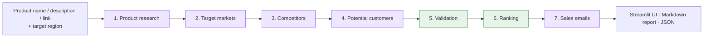

<div align="center">

# 📊 AI Market Intelligence for Industrial Products

**Give it a product. Get back target markets, real competitors, ranked potential customers, and personalised sales emails, each claim linked to a checked source.**


</div>

---

## Contents

- [What it does](#what-it-does)
- [Quick start](#quick-start)
- [Configuration](#configuration)
- [How it works](#how-it-works)
- [Customer ranking algorithm](#customer-ranking-algorithm)
- [Source validation](#source-validation)
- [Failure handling](#failure-handling)
- [Using the app](#using-the-app)
- [Testing](#testing)
- [Project structure](#project-structure)
- [Design decisions](#design-decisions)
- [Requirements coverage](#requirements-coverage)
- [Limitations](#limitations)

---

## What it does

An industrial manufacturer that wants to enter a new market has to find target countries, map competitors,
find buyers and decide whom to contact first. This MVP automates that research.

**Input:** a product name, a description and/or a link to the product page, plus a target country or region.
A link alone is enough.

**Output:**

| | |
|---|---|
| 🧩 **Product profile** | Features, applications and customer industries extracted from the web |
| 🌍 **Target markets** | At least 2 countries, each with a rationale and sources |
| 🏭 **Competitors** | At least 3 real companies with country, website, activity and reason |
| 🎯 **Potential customers** | At least 5 real companies, **ranked 0–100 by a deterministic algorithm**, with a full score breakdown |
| ✉️ **Sales emails** | Personalised English emails for the top 2 customers, sent to a test inbox after human approval |
| 🔗 **Source validation** | Each claim linked to a source that was fetched, checked for relevance and classified |
| 📄 **Report** | Downloadable Markdown report and raw JSON |

The sample product is an **industrial Battery Energy Storage System (BESS)**. Nothing in the code is
product-specific: the same code was tested live on compressors, motor drives and pumps across six regions (see
[Testing](#testing)).

---

## Quick start

```bash
git clone https://github.com/alireza-taheriF/market-intel-mvp.git
cd market-intel-mvp

python3 -m venv .venv && source .venv/bin/activate
pip install -r requirements.txt

cp .env.example .env        # add OPENAI_API_KEY (or ANTHROPIC_API_KEY), TAVILY_API_KEY, SMTP_*
streamlit run app.py        # → http://localhost:8501
```

```bash
pytest -q                                   # 45 tests, no network or API key needed
python scripts/simulate_failure.py          # command-line demo of every failure scenario
```

**Requirements:** Python 3.11+ (developed on 3.13). You need one LLM key (OpenAI or Anthropic) and a Tavily key.
Tavily's free tier is enough.

---

## Configuration

All settings live in `.env`. `.env.example` lists every option with comments.

### Services

| Variable | Default | Purpose |
|---|---|---|
| `LLM_PROVIDER` | `auto` | `openai`, `anthropic`, or `auto` (OpenAI when only `OPENAI_API_KEY` is set) |
| `OPENAI_API_KEY` · `OPENAI_MODEL` | — · `gpt-5.5` | OpenAI. Any chat model that supports JSON mode works |
| `ANTHROPIC_API_KEY` · `LLM_MODEL` | — · `claude-opus-5-5` | Claude, as an alternative to OpenAI |
| `LLM_EFFORT` | `medium` | Reasoning effort (`low`, `medium` or `high`) for both providers |
| `TAVILY_API_KEY` | — | Web search. **Recommended**: without it the app falls back to keyless DuckDuckGo search, which rate-limits after a few dozen queries |
| `SEARCH_PROVIDER` | `auto` | `auto`, `tavily` or `duckduckgo` |

### Tuning

| Variable | Default | Purpose |
|---|---|---|
| `MAX_PAGES_PER_STEP` | `20` | Sources fetched and sent to the LLM per research step |
| `RESULTS_PER_QUERY` | `6` | Search results per query |
| `HTTP_TIMEOUT_S` · `LLM_TIMEOUT_S` · `SMTP_TIMEOUT_S` | `12` · `180` · `20` | Timeouts for every external call |
| `RUNS_DIR` | `runs` | Where runs and logs are saved |

### Email (SMTP)

Gmail example. This needs 2-step verification and an [App Password](https://myaccount.google.com/apppasswords);
your normal Gmail password won't work.

```ini
SMTP_HOST=smtp.gmail.com
SMTP_PORT=587
SMTP_SECURITY=starttls       # starttls | ssl (port 465) | none
SMTP_USER=you@gmail.com
SMTP_PASSWORD=abcd efgh ijkl mnop
SMTP_FROM=you@gmail.com
```

> [!IMPORTANT]
> **Two safety rules are enforced in code (`messaging/email.py`), not just in the UI:**
> 1. **One recipient only.** Emails can only go to `behta.technicalteam@gmail.com`. This is a constant in the
>    code, deliberately not configurable, and the prospect's real address is never used.
> 2. **Human approval required.** The user reviews (and may edit) the text, ticks the approval box and presses
>    **Send Test Email**. `send_test_email(..., approved=False)` refuses to send.
>
> Every attempt, successful or not, is shown in the UI and appended to `runs/email_log.jsonl`.

---

## How it works



🟪 = web research and LLM extraction · 🟩 = deterministic code (no LLM)

**The core principle: the AI extracts, the code decides.** The LLM does what it is good at: reading
unstructured web pages, extracting entities and writing emails. Anything that has to be checkable and
reproducible is plain Python: validation, scoring, de-duplication and the final status.

### Each research step (1–4)

1. **Search:** a few queries built from the input and from the product's own keywords. Results from each query
   are interleaved, so every query contributes before the per-step cap.
2. **Fetch:** every source that will be sent to the LLM is fetched. This extracts the page text and records
   accessibility (HTTP status, error, timestamp).
3. **Extract:** the sources go to the LLM as numbered blocks (`[S1] … [Sn]`). The LLM must return JSON in which
   **every claim cites source ids**.
4. **Clean:** the JSON is treated as untrusted. Wrong types are dropped, `N/A`-style values become *unknown*,
   duplicates are merged, and competitors are removed from the customer list.

### Step details

| Step | What happens |
|---|---|
| **1 · Product** | With a link but no name, the product name is taken from the page title, or from the URL path if the page can't be read |
| **2 · Markets** | 2–4 markets with a sourced rationale. If the target is a single country, a neighbouring or similar market is added. The step retries once if it gets fewer than 2 |
| **3 · Competitors** | Real makers or sellers of the same kind of product. The product's own manufacturer is excluded |
| **4 · Customers** | Searches two kinds of buying signal: **(a)** projects or contracts for the product itself, **(b)** new plants and expansions in the industries that use it. Being listed in a sector directory doesn't count. If fewer than 5 customers are found, a second search round runs |
| **Websites** | Each company's website is found, matched to the company name and fetched (see [Design decisions](#design-decisions)) |
| **5 · Validation** | Each claim and each company record is checked against its sources (see [Source validation](#source-validation)) |
| **6 · Ranking** | 0–100 score per customer (see [Customer ranking algorithm](#customer-ranking-algorithm)) |
| **7 · Emails** | One email for each of the top 2 customers, using only verified or probable facts about that company |

### Run status

The status is derived from what the run actually produced, so a degraded run can never be presented as a
complete analysis.

| Status | Meaning |
|---|---|
| ✅ **COMPLETE** | Every step succeeded, and the minimums are met: ≥2 markets, ≥3 competitors, ≥5 customers, 2 AI-written emails |
| ⚠️ **PARTIAL** | Something failed or a minimum wasn't met. The UI says plainly that this is not a complete analysis |
| ❌ **FAILED** | Nothing usable was produced |

---

## Customer ranking algorithm

`scoring/ranking.py` is pure Python with no LLM or network access, and it is fully unit-tested.

```text
score    = 100 × Σ wᵢ · vᵢ          vᵢ ∈ [0, 1], or None (unknown) → contributes 0
coverage = Σ wᵢ over known criteria  (weights normalised to sum to 1)
```

| Criterion | Weight | How the value is computed (`scoring/features.py`) | Unknown when |
|---|---|---|---|
| **Industry fit** | 35% | Overlap between the customer's industry label and the product's target industries and applications. Generic words (*infrastructure*, *developer*, *services*…) are ignored, and plurals are matched (*Utilities* = *Utility*) | Industry unknown |
| **Geographic fit** | 25% | `1.0` = a target market or inside the target region · `0.5` = same wider region · `0` = outside | Country unknown |
| **Evidence of need** | 25% | Verified evidence counts 1, probable 0.5, unverified 0, divided by 2 and capped at 1. **Only evidence of a need counts:** it must name the product, or report a buying trigger (new plant, expansion, contract…) in a target industry. *"Listed among manufacturing startups"* earns 0 | No evidence |
| **Data reliability** | 15% | Company record verified = 1 (website reachable **and** the company is named in a cited source), probable = 0.5, unverified = 0 | — |

**Properties**

- **Adjustable weights:** sidebar sliders re-rank instantly, with no LLM call. Weights must be ≥ 0 with at least
  one > 0, and are normalised.
- **No points without evidence:** an unknown criterion contributes exactly 0. `coverage` shows whether a low
  score comes from poor fit or from missing data.
- **Deterministic ties:** ordered by score ↓, coverage ↓, supported evidence count ↓, name (case-insensitive) ↑,
  then id ↑. Equal scores never depend on input order.
- **Exact:** the score is summed from unrounded points, so equal scores stay exactly equal.
- **Auditable:** the UI shows each criterion's value, weight, points and reason, plus the full formula.

**Worked example** (Saudi Electricity Company, live run):

```text
Industry fit      1.00 × 0.35 = 35.00   "Electric utility" matches target "Utilities"
Geographic fit    1.00 × 0.25 = 25.00   Saudi Arabia is a target market
Evidence of need  0.75 × 0.25 = 18.75   1 verified + 1 probable product-related item
Data reliability  0.50 × 0.15 =  7.50   record probable
                          score = 86.25
```

---

## Source validation

Every important claim is checked by deterministic code (`processing/validation.py`). This covers product
features, applications and industries, market rationales, competitor reasons, and customer fit reasons and
evidence of need.

| Check | How |
|---|---|
| **Source recorded** | Each claim cites source ids. Ids that don't exist (the LLM invented them) are flagged and ignored |
| **Accessible** | Each source is fetched at collection time; HTTP status, error and timestamp are stored |
| **Relevant** | Share of the claim's content words found in the source text (0–1). For a claim about a company, the company's name must appear, otherwise relevance is capped at 0.2 |
| **Source type** | 🏢 **official** (the company's or manufacturer's own domain) · 📰 **independent** (news, industry media, research, government or education, from a curated list) · ❔ **unknown** (credibility not established; social networks and company directories are always unknown) |

**Verdict per claim**

| | Rule |
|---|---|
| ✅ **verified** | Relevant text in an accessible official or independent source, **or** two separate supporting sources |
| 🟡 **probable** | One weaker supporting source |
| ⚠️ **unverified** | No usable evidence. Don't rely on it |

The *Sources & Validation* tab can filter down to the claims that lack sufficient evidence.

---

## Failure handling

Every failure of an external service becomes a **typed error with a readable message**
(`NetworkError`, `ServiceTimeoutError`, `InvalidResponseError`, `LLMUnavailableError`, `EmailError`).
Each step runs in isolation, so one failure never stops the whole run.

| Scenario | Behaviour |
|---|---|
| **No internet / source unreachable** | Unreachable pages are recorded as such, and their search snippet is used. If search itself is down, the step fails with a message, later search steps are **skipped** instead of waiting again, and the run is **FAILED** |
| **API error / timeout** | Single failed queries are tolerated; a step fails only if every query fails |
| **Empty / invalid response** | An empty search gives a clear "no results / rate-limited" message. HTML, broken JSON, truncated output or a refusal from the LLM is rejected and never used as data |
| **AI model unavailable** | Bad key, no connection, rate limit or timeout. Sources already collected are kept, later AI steps are skipped, and the run is **PARTIAL** or **FAILED**. If only email writing fails, a draft is shown, labelled *not AI-personalised* |
| **SMTP failure** | The email isn't sent, and the reason (auth, connection, timeout, configuration) is shown and logged |

**Collected data is preserved:** earlier steps' results survive a later failure, every run is saved to
`runs/run-*.json` and can be reloaded, and if a new run fails the UI keeps showing the last valid result.

### Demonstrating a failure

Faults are injected **inside the service clients**, so the real error path runs end to end, not a mocked
screen. There are three ways to trigger them:

- **Sidebar → Failure simulation:** pick one of 5 scenarios (internet down, search timeout, AI unavailable, AI
  invalid response, SMTP failure), then run an analysis or send an email.
- **Failure handling tab → Quick demo:** runs the pipeline with the internet "down" in one click.
- **`python scripts/simulate_failure.py`:** runs every scenario from the command line.

Results are logged to `runs/failure_log.jsonl`.

---

## Using the app

| Tab | What you see |
|---|---|
| **Overview** | Run status, step log (✅ ok · ⚠️ warning · ❌ failed · ⏭️ skipped, with timings), counts, de-duplication log, and report downloads |
| **Product** | Features, applications and industries, each with a verification badge and source links |
| **Markets & Competitors** | Market cards with rationale and sources, and a competitor table (columns below) |
| **Customers & Scores** | Ranked table, and for each customer: fit reason, evidence, per-criterion breakdown and the formula |
| **Sales Emails** | Editable emails, the facts they use, the fixed recipient, an approval checkbox and **Send Test Email** |
| **Sources & Validation** | Every source and every claim with its verdict |
| **Failure handling** | Scenarios, the quick demo, and the failure and email logs |

**Sidebar:** service status · failure simulation · ranking weights · reload previous runs.

<details>
<summary><b>Column reference</b></summary>

**Competitors and customers**

| Column | Meaning |
|---|---|
| Country | Headquarters (competitors) or project site (customers). *⚠️ general knowledge* = from the model's knowledge, not from a source |
| Record status | ✅ website reachable **and** named in a cited source · 🟡 one of the two · ⚠️ neither |
| Website reachable | `yes` / `no` / `—` (no website to check) |
| Website from | *cited source* · *search (name↔domain match)* · *model knowledge (name↔domain match)* |
| Missing data | Fields that couldn't be found (shown as UNKNOWN, never guessed) |
| Score / Coverage | 0–100 score / share of the weight backed by known data |

**Sources**

| Column | Meaning |
|---|---|
| ID | `S1`, `S2`…, used as the citation across the whole report |
| Type | official / independent / unknown |
| Accessible · HTTP · Error | Fetch result at collection time (e.g. `403` = blocked, `404` = not found) |
| Checked at · Found by | Timestamp, and the search query that found the source |

**Claims**

| Column | Meaning |
|---|---|
| Relevance | Share of the claim's content words found in the source (0–1) |
| Note | Why a claim is weak, e.g. *ignored non-existent source ids* |

</details>

---

## Testing

### Automated tests

`pytest -q` runs **45 tests**. They need no network or API key: the external services are replaced by fakes.

| File | Tests | Covers |
|---|---|---|
| `test_ranking.py` | 17 | Ranking: weight changes, incomplete data, ties, explainability, feature rules |
| `test_processing.py` | 11 | Cleaning, de-duplication, source classification, claim verification, website matching, product name from a link |
| `test_failures.py` | 9 | AI outage mid-run, internet down, invalid LLM answers, email whitelist, approval gate, SMTP failures |
| `test_llm.py` | 3 | OpenAI response handling and error mapping |
| `test_pipeline.py` | 2 | End-to-end run with fakes reaching `complete`, plus query interleaving |

**The three ranking checks the brief requires:**

- **Weight changes:** moving weight from industry to geography reverses the order of an industry-strong and a
  geo-strong customer. Raising a weight raises the score of a customer that is strong in it, a weight of 0
  removes a criterion's influence, and scaling all weights changes nothing.
- **Incomplete data:** unknown criteria earn 0 points and lower coverage, an all-unknown customer scores 0 and
  ranks last, and unverified evidence or evidence unrelated to a need earns nothing.
- **Equal scores:** shuffling the input 10 times always gives the same order, and the tie-breakers apply in the
  documented order.

### Live tests

These were run against real services, with a different product, region or input type in each case:

| Case | Input | Result |
|---|---|---|
| BESS · Middle East (GCC) | name + description | ✅ COMPLETE: SEC, ACWA Power, Masdar, EWEC… |
| BESS · Germany | name + description | ✅ COMPLETE: Stadtwerke Mühlacker, RWE, BayWa r.e.… |
| Rotary screw compressor · Vietnam | name + description | ✅ COMPLETE: VinFast, Suntory PepsiCo, Crown… |
| Kaeser compressors · no region | **link only** | ✅ COMPLETE: name taken from the page title |
| Grundfos CR pumps · Brazil | **link only, page unreachable** | ✅ COMPLETE: name taken from the URL; Braskem, Suzano… |
| Danfoss VLT drive · India | **link only** | ⚠️ PARTIAL (3/5 customers), correctly reported as incomplete |

---

## Project structure

```text
app.py                         Streamlit UI (presentation only, no business logic)
market_intel/
├── core/
│   ├── config.py              settings from .env; the fixed test recipient
│   ├── models.py              dataclasses shared by every stage (no UI or LLM dependency)
│   ├── errors.py              typed external-service errors with readable messages
│   └── faults.py              fault-injection flags for the failure simulation
├── collectors/
│   ├── search.py              Tavily / DuckDuckGo behind one interface
│   └── fetcher.py             page fetch, text extraction, accessibility check (never raises)
├── processing/
│   ├── sources.py             source registry: stable ids S1, S2… and URL de-duplication
│   ├── cleaning.py            normalisation, unknown values, de-duplication, website matching
│   └── validation.py          source classification and claim verification (no LLM)
├── ai/
│   ├── llm.py                 OpenAI / Claude client: JSON-only answers, SDK errors → typed errors
│   ├── prompts.py             product-agnostic prompt templates
│   └── extraction.py          LLM JSON → typed, cleaned objects (LLM output treated as untrusted)
├── scoring/
│   ├── features.py            company → criterion values (rules only; unknown stays None)
│   └── ranking.py             the ranking algorithm (pure Python)
├── messaging/
│   ├── sales.py               personalised emails, with a labelled template fallback
│   └── email.py               SMTP with the recipient whitelist and approval gate
├── pipeline.py                orchestration, per-step error isolation, final status
├── report.py                  Markdown report
└── storage.py                 run persistence and failure log
scripts/simulate_failure.py    command-line failure demo
tests/                         45 offline tests
```

---

## Design decisions

| Decision | Why |
|---|---|
| **The AI extracts, the code decides** | Ranking and verification must be testable and reproducible, and the brief requires a ranking algorithm independent of the LLM. LLM output varies between runs |
| **Numbered sources with mandatory citations** | Every claim traces back to a URL, and invented source ids are caught and discarded |
| **Validation by code, not by asking the LLM** | Asking a model to grade its own claims is circular. The code checks that the source exists, was reachable, contains the claim's content and is credible |
| **Unknown = `None`, never a default number** | Missing data can't earn points. `coverage` keeps a low-data score distinguishable from a poor-fit score |
| **Evidence of need must be about a need** | Live runs showed customers that were in the list only because a directory mentioned them. Only product-related evidence, or a buying trigger in a target industry, earns points |
| **Websites are checked, not trusted** | A wrong website is worse than none. One found by search or from model knowledge is accepted only if its domain is made entirely of the company's name words plus usual endings (`alsharifgroup` = al + sharif + group ✓; `ashlandmass`, a town, ✗), it isn't `.edu` or `.gov` for a company, and it's reachable. 2-letter initials are ambiguous, so they're never used (*Saudi Energy* ≠ `se.com.sa`) |
| **Fields from general knowledge are flagged** | A competitor's headquarters country may come from model knowledge when the sources are silent, and it is then labelled as such |
| **Typed errors and per-step isolation** | The app never crashes on an outage, the UI always gets a readable message, and steps that depend on a dead service are skipped rather than left waiting |
| **Fault injection inside the clients** | The demo runs the real error path end to end |
| **Status derived from output** | A partial result can never be shown as a complete analysis |
| **Email safety in code** | The recipient whitelist and the approval gate can't be bypassed by changing the UI or the settings |
| **Two LLM providers behind one client** | OpenAI and Claude are interchangeable with `LLM_PROVIDER`, and the rest of the system doesn't know which one runs |
| **Product-agnostic by construction** | Prompts and queries are built from the input and from the product's extracted keywords. Customer search combines generic buying signals instead of energy-specific ones |
| **Plain dataclasses, no framework** | Small, readable and easy to test; any stage can be replaced |

---

## Requirements coverage

<details>
<summary><b>How each requirement in the brief is met</b></summary>

| Requirement | Where |
|---|---|
| Product name, description or link, plus target region | Input form · `pipeline._step_product` (link-only supported) |
| Collect product information, features, applications, industries | `collectors/` · `ai/prompts.product_profile` |
| Structured data, stored source links, duplicates and incomplete data handled | `core/models.py` · `processing/sources.py` · `processing/cleaning.py` |
| ≥2 markets and ≥3 real competitors (name, country, website, activity), reasons with sources | Steps 2–3 · *Markets & Competitors* tab |
| ≥5 real customers (name, country, industry, website), fit reason, verified vs uncertain | Step 4 · *Customers & Scores* tab |
| Ranking 0–100, adjustable weights, no credit for unknowns, sorted, breakdown, auditable | `scoring/` · sidebar sliders · per-customer breakdown and formula |
| ≥3 automated ranking tests: weights, incomplete data, ties | `tests/test_ranking.py` |
| Personalised English emails for the top 2 | `messaging/sales.py` · *Sales Emails* tab |
| Source link per claim, accessibility, relevance, source type, unsupported claims flagged | `processing/validation.py` · *Sources & Validation* tab |
| Streamlit UI: input, Start Analysis, progress, results, readable errors | `app.py` |
| Controlled behaviour on outages; data kept; partial result never shown as complete | `core/errors.py` · `pipeline.py` · `tests/test_failures.py` |
| Demonstrate a failure scenario | Failure simulation · Quick demo · `scripts/simulate_failure.py` |
| Test email via SMTP, only to the allowed address, only after human approval | `messaging/email.py` · *Sales Emails* tab |
| README: how to run, dependencies, email setup, limitations | This file |

</details>

---

## Limitations

- **Results vary between runs.** Web search and the LLM are non-deterministic. The ranking itself is
  deterministic for a given set of collected data.
- **Validation is lexical.** It shows that a source *discusses* a claim, not that the claim is true.
  Paraphrased claims can score lower than they deserve.
- **Many sources are labelled *unknown*.** The list of independent publishers is curated and incomplete, which
  is deliberately conservative: an unknown source alone makes a claim *probable*, not *verified*.
- **Unreadable pages.** Pages behind bot protection or JavaScript rendering can't be read; they are recorded as
  inaccessible and their search snippet is used.
- **Some websites stay unknown.** Website matching prefers *unknown* to *wrong*, so companies with ambiguous names
  or unusual domains may have no website.
- **Narrow products may find fewer customers.** When few target industries are extracted, a run can find fewer
  than 5 customers; it is then reported as PARTIAL.
- **Coarse geography.** The region map covers major regions only. A customer with an unknown country gets no
  geographic credit.
- **No contact people.** No contact persons or email addresses are collected; emails go only to the test inbox.
- **Runs are synchronous.** A run takes about 3–5 minutes (≈20 searches, ≈80 page fetches, 6–8 LLM calls), and
  there is no job queue.
